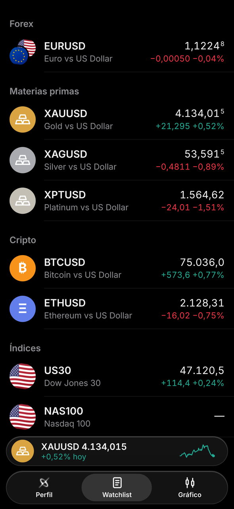
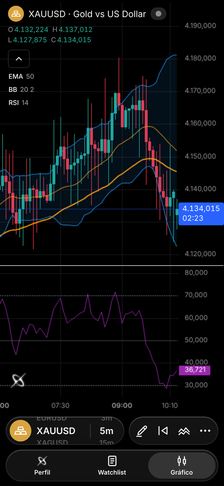
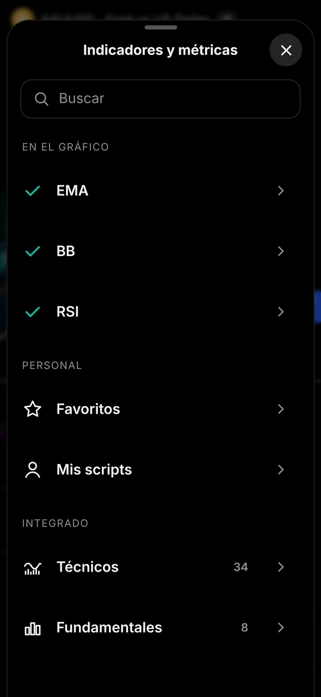
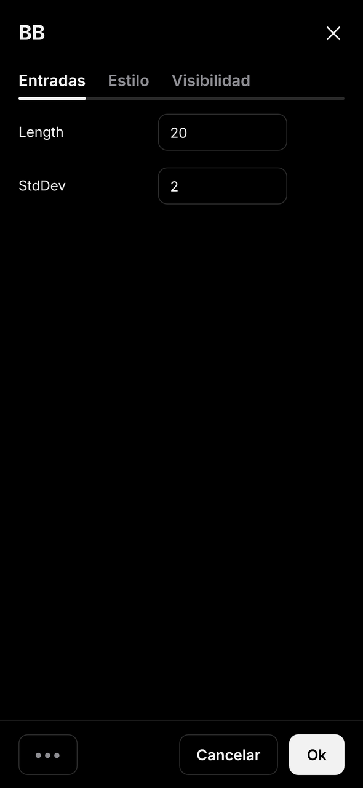
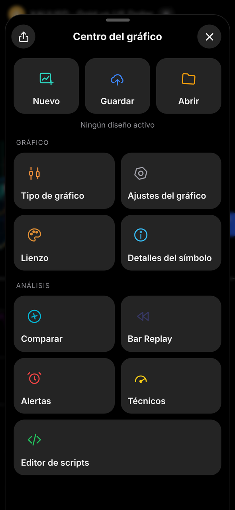
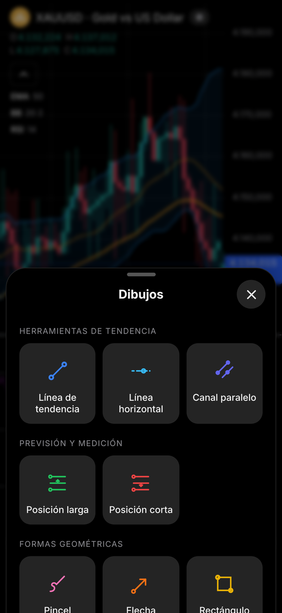
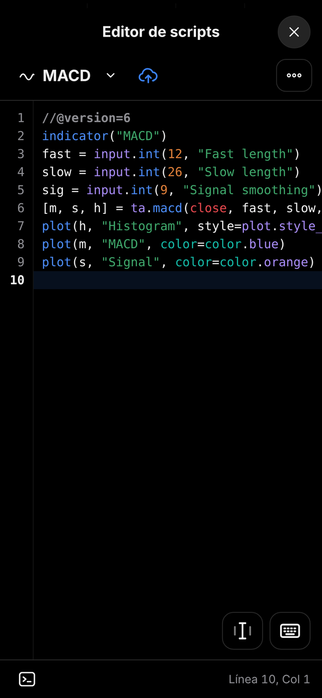
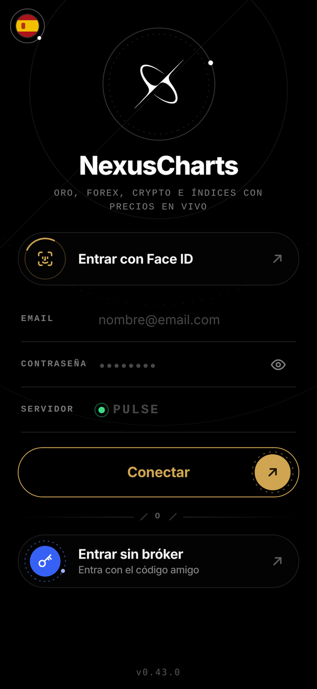

# NexusCharts

**Gráficos en tiempo real, indicadores, scripts y alertas — siempre en tu bolsillo.**
Una app de gráficos rápida y bonita para iPhone, Android y ordenador, con un diseño negro absoluto inspirado en las órbitas.

[English](README.md) · [Italiano](README.it.md) · **Español** · [Français](README.fr.md)

  
  
  
  

  
  
  
  

---

## 📖 Índice

- [Qué es NexusCharts](#-qué-es-nexuscharts)
- [Funciones](#-funciones)
- [Instalación](#-instalación)
- [Cómo conseguir acceso](#-cómo-conseguir-acceso)
- [Compatibilidad](#-compatibilidad)
- [Privacidad y seguridad](#-privacidad-y-seguridad)
- [Cómo está hecha](#%EF%B8%8F-cómo-está-hecha)
- [Números de versión](#-números-de-versión)
- [Preguntas frecuentes](#-preguntas-frecuentes)
- [Próximamente](#-próximamente)
- [Créditos](#-créditos)

---

## ✨ Qué es NexusCharts

NexusCharts es una **web app** que se instala en la pantalla de inicio y funciona como una app de verdad: a pantalla completa, con su propio icono, sin pasar por la App Store.
Está pensada para traders que quieren **gráficos limpios, precios en tiempo real, indicadores y herramientas de dibujo** en el móvil, sin límites, anuncios ni suscripciones.

| | |
|---|---|
| ⚡ **Precios en vivo** | Cotizaciones y velas se actualizan solas cada pocos segundos |
| 📈 **42 indicadores + tus scripts** | Biblioteca integrada y un motor compatible con Pine Script™ |
| 🔔 **Alertas de verdad** | Notificaciones push incluso con la app cerrada |
| 📱 **Como una app nativa** | Pantalla completa, vibración al tocar, animaciones fluidas, sin barras del navegador |
| 🔄 **Siempre actualizada** | Cada vez que la abres tienes la última versión, automáticamente |
| 🌍 **4 idiomas · 2 temas** | Italiano, inglés, español, francés · Oscuro y claro |

> 📝 Las novedades de cada versión están en la página [Releases](../../releases).

### 🆕 Novedades de la 0.43.0 — Acceso Design 3.0

- 🔐 **Nueva pantalla de acceso**, hecha exactamente como el prototipo Design 3.0: logo de órbitas, escáner de Face ID, campos estilo consola y botones dorado y azul con un anillo discontinuo que gira.
- 🔢 **Código de acceso en 8 casillas** (4 + 4): cada carácter cae en su casilla y los ocho segmentos alrededor del logo se encienden uno a uno. Si el código es incorrecto se ponen rojos y tiemblan.
- 💫 **Transición del logo cada vez que abres la app**, no solo después de las pantallas de bienvenida.
- 🏳️ **Banderas de idioma redondas** en toda la app.
- 🧹 **Acceso más limpio**: *Restablecer la app* ahora está solo en Perfil › Ajustes.
- 🖤 **0.43.1**: pantalla de inicio negra y sin el antiguo logo brillante al abrir, el nuevo logo limpio en toda la app, sin fondo amarillo cuando el iPhone rellena tu email y contraseña, y el campo Servidor vacío muestra solo el punto verde.

Anteriormente, en la 0.42.0

- 🪐 **Nuevas pantallas de bienvenida**: seis diapositivas breves con el logo de órbitas, que se muestran **una sola vez** en cada dispositivo. Puedes saltarlas cuando quieras.
- 💫 **Animación del logo**: en las aperturas siguientes el logo se desliza del centro a la parte superior de la pantalla de acceso.
- 🌍 **Menú de idiomas en órbita**: toca la bandera y elige italiano, inglés, español o francés. Tu elección queda guardada.
- ⬛ **Pantalla de acceso negro absoluto** con botones más grandes y modernos. El acceso, los códigos y Face ID funcionan como antes.

---

## 🚀 Funciones

### 📋 Watchlist
- Forex, materias primas, cripto, índices y acciones, agrupados por categoría
- Busca cualquier símbolo y añádelo con un toque
- Precio en vivo, variación diaria en puntos y porcentaje, iconos con banderas y monedas
- Mini reproductor abajo con el símbolo seleccionado y su minigráfico

### 📊 Gráfico
- Gráfico a pantalla completa con **actualización en vivo** y **cuenta atrás** de la vela
- **Temporalidades:** segundos 1s · 5s · 10s · 15s · 30s · 45s — minutos 1m · 3m · 5m · 15m · 30m · 45m — horas 1H · 2H · 3H · 4H — días 1D · 1W · 1M · 3M · 6M · 12M
- **Tipos de gráfico:** Velas · Barras · Línea · Área · Heikin Ashi
- **Colores personalizados:** cuerpo, bordes y mechas de las velas con opacidad, además del fondo y las escalas
- **Selector rápido:** mantén pulsado y desliza sobre la píldora del símbolo o de la temporalidad para cambiarla al instante
- **Retícula** con etiquetas de precio y hora y **botón "+"** para crear alertas rápidas
- **Compara** un segundo símbolo en porcentaje
- Pellizca para hacer zoom, arrastra para desplazarte, comparte una imagen del gráfico

### 📈 Indicadores
- Pantalla **Indicadores y métricas** con búsqueda, **Favoritos** (toca la estrella) y **Mis scripts**
- **34 Técnicos:** SMA, EMA, WMA, HMA, VWMA, ALMA, MA Ribbon, Bandas de Bollinger (+ %B y BandWidth), Keltner, Donchian, Envelopes, Supertrend, Ichimoku, VWAP, Regresión lineal, RSI, Stoch RSI, Estocástico, MACD, CCI, ADX, ATR, MFI, Williams %R, Momentum, ROC, Awesome Oscillator, Aroon, OBV, Volumen, Pivot Points, ZigZag
- **8 Fundamentales** (calculados a partir de los precios): máximo/mínimo del día y de la semana anterior, apertura diaria, rango medio diario, variación diaria %, volatilidad histórica, máximo/mínimo de 52 semanas, máximo/mínimo de la sesión
- **Leyenda compacta:** toca un indicador para **mostrarlo/ocultarlo**, abrir sus **ajustes** o **quitarlo**
- **Ventana de ajustes** con **Entradas**, **Estilo** (visibilidad, color y grosor de cada línea) y **Visibilidad** (minutos / horas / días)
- **Menú •••:** restablece los ajustes o **guarda como predeterminado** para la próxima vez que lo añadas

### 🧩 Editor de scripts
- Escribe tus propios indicadores en un lenguaje **compatible con Pine Script™** (v5/v6)
- Editor de código con números de línea, comprobación de errores y consola
- Admite plots, formas, cajas, líneas, etiquetas, tablas, rellenos, entradas, alertas, temporalidades superiores y sesiones
- Guarda tus scripts y añádelos al gráfico desde **Mis scripts**

### ✏️ Herramientas de dibujo
Se guardan automáticamente para cada símbolo.

| Grupo | Herramientas |
|---|---|
| Tendencia | Línea de tendencia · Línea horizontal · Canal paralelo |
| Previsión y medición | Posición larga · Posición corta (con objetivo, stop y R:R) |
| Formas | Pincel · Flecha · Rectángulo · Trayectoria · Elipse |
| Anotaciones | Texto · Nota |

Selecciona un dibujo para moverlo, cambiarle el color o eliminarlo.

### 🔔 Alertas
- Crea una alerta de precio desde el **"+"** de la retícula o desde el gestor de **Alertas**
- Línea de la alerta en el gráfico: tócala para eliminarla
- Lista de activas / inactivas, cancelar y eliminar
- **Notificaciones push incluso con la app cerrada** (se desactivan en Perfil › Notificaciones)

### ⏪ Bar Replay
- Coloca una **línea guía** en la vela exacta que quieras y empieza desde ahí
- Reproduce de 1x a 10x o avanza vela a vela: perfecto para hacer backtesting

### 🧭 Centro del gráfico
| Sección | Qué hace |
|---|---|
| **Diseños** | Nuevo · Guardar · Abrir tus configuraciones del gráfico |
| **Gráfico** | Tipo, ajustes del gráfico, lienzo, detalles del símbolo |
| **Análisis** | Comparar · Bar Replay · Alertas · Técnicos · Editor de scripts |
| **Técnicos** | Indicador de compra/venta a partir de osciladores y medias móviles |
| **Compartir** | Crea una imagen del gráfico y abre el menú para compartir |

### 👤 Perfil y ajustes
- Tema (oscuro/claro), idioma y notificaciones
- Formulario para avisar de un problema o proponer una idea
- Actualizar datos, restablecimiento seguro, salir

---

## 📲 Instalación

> NexusCharts se instala desde el navegador: sin App Store ni Play Store.

### 🍎 iPhone (Safari)
1. Abre el enlace de NexusCharts con **Safari**.
2. Toca **Compartir** (el cuadrado con la flecha). En iOS 26 toca primero los **tres puntos ⋯** y luego **Compartir**.
3. Toca **Añadir a pantalla de inicio** (si no lo ves, toca **Ver más**).
4. Deja activado **Abrir como app web**, comprueba que el nombre sea **NexusCharts** y toca **Añadir**.
5. Abre **NexusCharts** desde la pantalla de inicio.

### 🤖 Android (Chrome)
1. Abre el enlace de NexusCharts con **Chrome**.
2. Toca los **tres puntos ⋮** arriba a la derecha.
3. Toca **Instalar aplicación** (o **Añadir a pantalla de inicio**) y confirma.

### 💻 Ordenador (Chrome / Edge)
1. Abre el enlace de NexusCharts.
2. Haz clic en el **icono de instalar** de la barra de direcciones, o úsala en una pestaña normal.

---

## 🔑 Cómo conseguir acceso

NexusCharts funciona con **códigos de acceso personales**: sin registro y sin cuenta en un bróker.

1. Pide tu código en Telegram 👉 **[t.me/albaexe](https://t.me/albaexe)**
2. Abre la app y toca **Entrar sin bróker**.
3. Escribe el código (formato `XXXX-XXXX`) y ya estás dentro.

A partir de ahí la app te deja entrar sola.

¿Ya habías entrado? Después de una actualización puede que veas una vez las pantallas de bienvenida: tu código sigue guardado y la app te deja entrar como siempre.

> ⚠️ Cada código funciona en **un solo dispositivo**, como una licencia. Si cambias de móvil o restableces la app, pide uno nuevo.

---

## ✅ Compatibilidad

| Dispositivo | Navegador | Estado |
|---|---|---|
| iPhone (iOS 16.4 o posterior) | Safari | ✅ Recomendado |
| iPhone | Chrome / Edge | ✅ Funciona (instalar desde Compartir) |
| Android 10 o posterior | Chrome | ✅ Compatible |
| Android | Samsung Internet / Edge | ✅ Funciona |
| iPad | Safari | ⚠️ Funciona, pensada para móviles |
| Ordenador | Chrome / Edge / Safari | ⚠️ Funciona, versión completa para ordenador en camino |

**Requisitos:** conexión a internet. En iPhone las notificaciones push necesitan la app instalada en la pantalla de inicio.

---

## 🔒 Privacidad y seguridad

- 🚫 **No se piden datos personales** para usar la app con un código.
- 📱 Dibujos, diseños, indicadores, scripts y ajustes se guardan **solo en tu dispositivo**.
- 🔔 Si activas las notificaciones, tus alertas activas se guardan en el servidor solo para avisarte; borras la alerta y desaparece.
- 🔐 En este repositorio no hay contraseñas ni claves privadas.
- 🎟️ Los códigos de acceso están ligados a un solo dispositivo y se pueden revocar en cualquier momento.
- 🛡️ **Protección contra quien intenta adivinar los códigos**: tras demasiados códigos erróneos desde la misma red, el acceso se pausa un rato y la app muestra un mensaje claro. Los códigos válidos y los dispositivos vinculados no se tocan.
- 🧹 **Restablecer la app** borra todo lo guardado en el dispositivo.

---

## 🏗️ Cómo está hecha

- 🖥️ **La app** (lo que ves en pantalla) está en este repositorio y se publica como web app.
- ⚙️ **El motor** funciona en Cloudflare: comprueba los códigos de acceso, trae los precios en vivo y envía las alertas. Se gestiona aparte y no forma parte de este repositorio.
- 🔐 Las claves y contraseñas están solo en los ajustes cifrados del motor, nunca en el código.

---

## 🔢 Números de versión

Las versiones tienen tres números, **MAYOR.MENOR.CORRECCIÓN** (por ejemplo 0.43.0):

- **Primer número**: cambios grandes.
- **Número central**: funciones nuevas.
- **Último número**: correcciones y mejoras.

---

## ❓ Preguntas frecuentes

<b>¿Tengo que pagar o suscribirme?</b>

No. Instalar y usar NexusCharts es gratis: solo necesitas un código de acceso.

<b>¿Necesito una cuenta en un bróker?</b>

No. Con un código de acceso entras sin registrarte en ningún bróker.

<b>¿Puedo operar desde la app?</b>

No. NexusCharts es solo para gráficos y análisis: nunca abre órdenes.

<b>¿Puedo usar mis indicadores de Pine Script™?</b>

Sí. Pega el script en el Editor de scripts, guárdalo y añádelo desde Mis scripts. Se admite la mayoría de las funciones v5/v6; si algo no lo está, la consola te indica la línea.

<b>¿Las alertas funcionan con la app cerrada?</b>

Sí, con las notificaciones push activadas. En iPhone la app debe estar instalada en la pantalla de inicio.

<b>El código dice que ya se usa en otro dispositivo.</b>

Cada código funciona en un solo dispositivo. Pide uno nuevo en Telegram.

<b>¿Tengo que actualizar la app?</b>

No. Se actualiza sola cada vez que la abres.

<b>¿Los dibujos e indicadores se sincronizan entre dispositivos?</b>

Todavía no: se quedan en el dispositivo donde los creaste.

---

## 🗺️ Próximamente

| Estado | Función |
|---|---|
| ✅ | Watchlist, gráfico en vivo, temporalidades, tipos de gráfico, colores personalizados |
| ✅ | Herramientas de dibujo, Bar Replay, Centro del gráfico, diseños |
| ✅ | 42 indicadores integrados, favoritos, ajustes de indicador |
| ✅ | Motor compatible con Pine Script™ y editor de scripts |
| ✅ | Alertas de precio con notificaciones push |
| ✅ | 4 idiomas, tema oscuro y claro |
| ✅ | Design 3.0: pantallas de bienvenida, animación del logo, menú de idiomas en órbita |
| ✅ | Acceso Design 3.0: logo de órbitas, código en 8 casillas, banderas redondas |
| 🔜 | Carga de datos más rápida |
| 🔜 | Versión completa para ordenador |
| 💡 | Sincronización entre dispositivos |

---

## 🙏 Créditos

- Gráficos creados con [TradingView Lightweight Charts™](https://www.tradingview.com/lightweight-charts/) (Apache 2.0).
- TradingView y Pine Script son marcas de TradingView, Inc. NexusCharts no está afiliada a TradingView.

---

## ⚠️ Aviso

NexusCharts es una herramienta de análisis. Nada en la app es asesoramiento financiero. El trading conlleva riesgos: haz siempre tu propio análisis.

**© 2026 NexusCharts — Todos los derechos reservados.**

