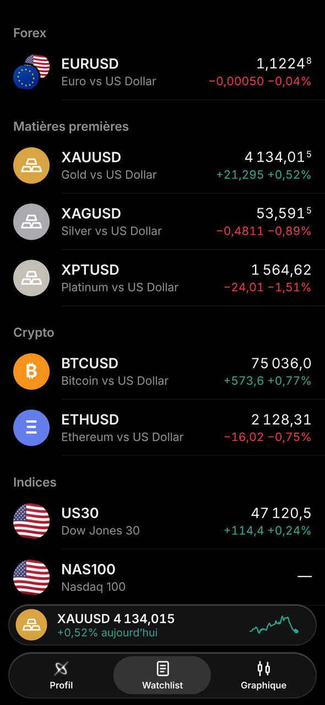
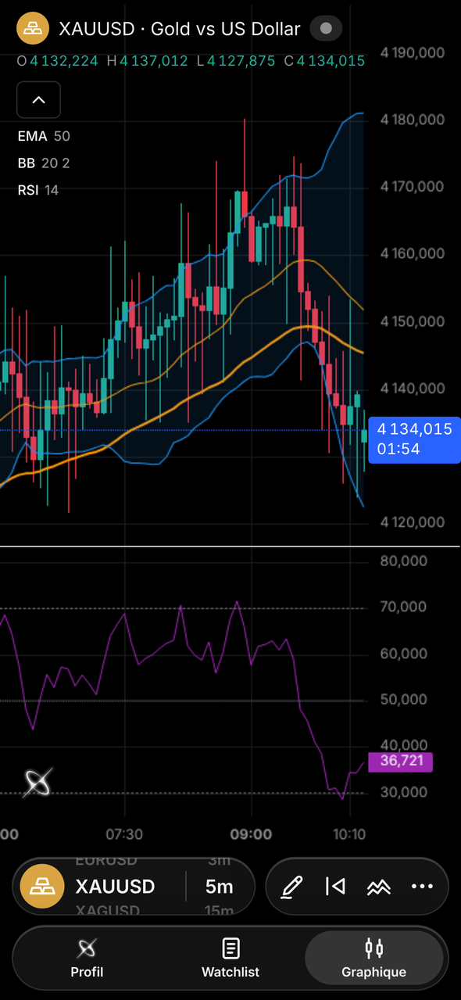
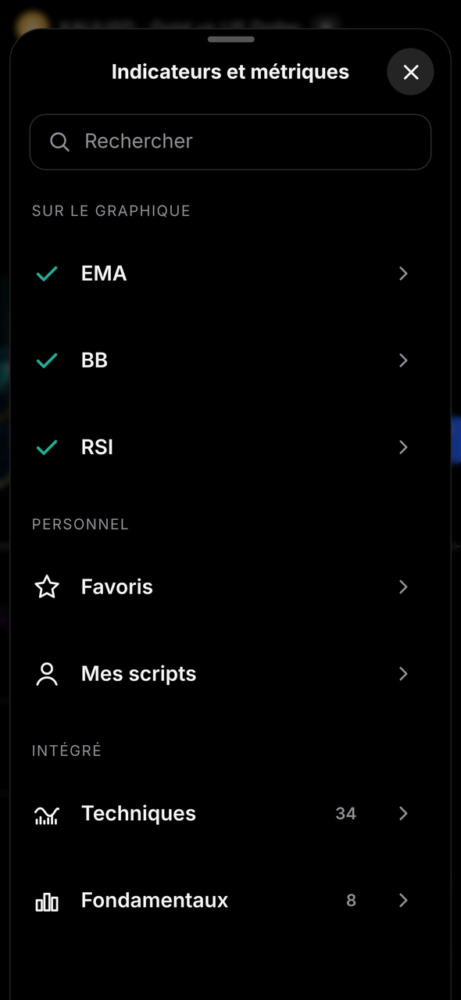
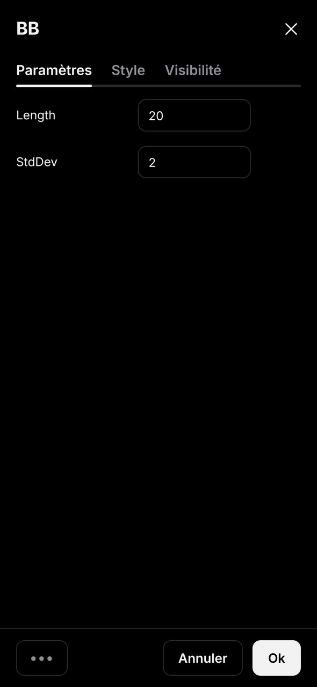
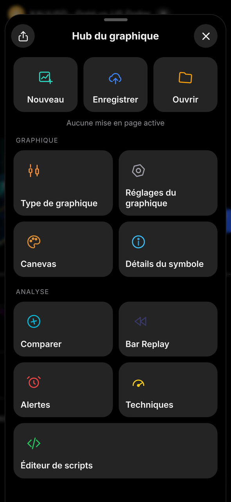
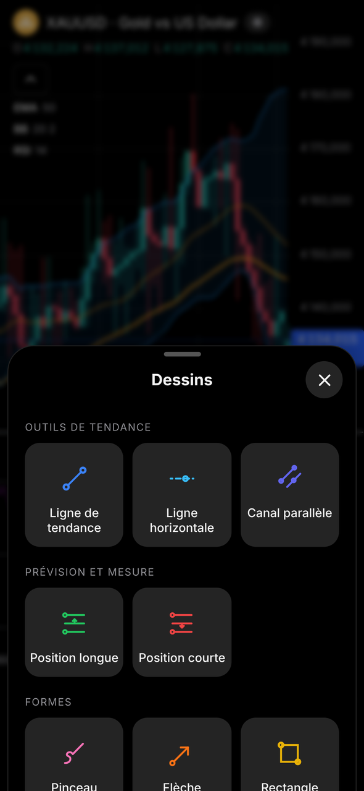
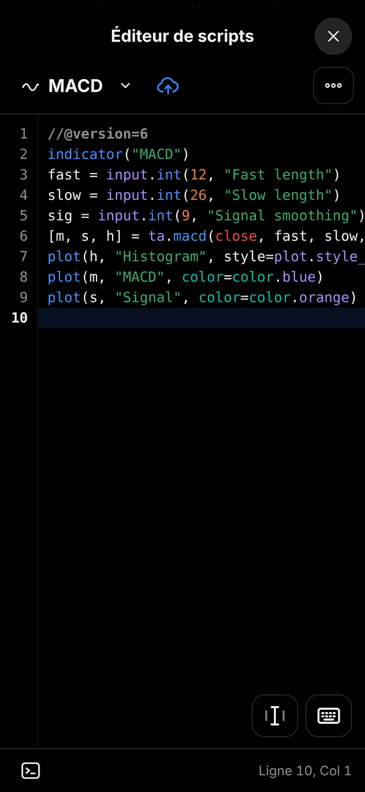
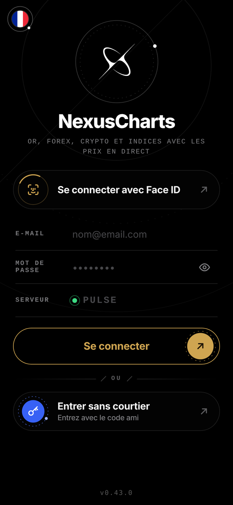

# NexusCharts

**Graphiques en temps réel, indicateurs, scripts et alertes — toujours dans ta poche.**
Une app de graphiques rapide et élégante pour iPhone, Android et ordinateur, avec un design noir absolu inspiré des orbites.

[English](README.md) · [Italiano](README.it.md) · [Español](README.es.md) · **Français**

  
  
  
  

  
  
  
  

---

## 📖 Sommaire

- [Qu'est-ce que NexusCharts](#-quest-ce-que-nexuscharts)
- [Fonctions](#-fonctions)
- [Installation](#-installation)
- [Comment obtenir l'accès](#-comment-obtenir-laccès)
- [Compatibilité](#-compatibilité)
- [Confidentialité et sécurité](#-confidentialité-et-sécurité)
- [Comment elle est faite](#%EF%B8%8F-comment-elle-est-faite)
- [Numéros de version](#-numéros-de-version)
- [Questions fréquentes](#-questions-fréquentes)
- [Prochainement](#-prochainement)
- [Crédits](#-crédits)

---

## ✨ Qu'est-ce que NexusCharts

NexusCharts est une **web app** qui s'installe sur l'écran d'accueil et fonctionne comme une vraie app : en plein écran, avec sa propre icône, sans passer par l'App Store.
Elle est pensée pour les traders qui veulent des **graphiques clairs, des prix en temps réel, des indicateurs et des outils de dessin** sur leur téléphone, sans limites, publicités ni abonnements.

| | |
|---|---|
| ⚡ **Prix en direct** | Cotations et bougies se mettent à jour toutes seules toutes les quelques secondes |
| 📈 **42 indicateurs + tes scripts** | Bibliothèque intégrée et un moteur compatible Pine Script™ |
| 🔔 **De vraies alertes** | Notifications push même quand l'app est fermée |
| 📱 **Comme une vraie app** | Plein écran, vibration au toucher, animations fluides, pas de barres du navigateur |
| 🔄 **Toujours à jour** | À chaque ouverture tu as la dernière version, automatiquement |
| 🌍 **4 langues · 2 thèmes** | Italien, anglais, espagnol, français · Sombre et clair |

> 📝 Les nouveautés de chaque version sont sur la page [Releases](../../releases).

### 🆕 Nouveautés de la 0.43.0 — Connexion Design 3.0

- 🔐 **Nouvel écran de connexion**, fait exactement comme le prototype Design 3.0 : logo en orbite, scanner Face ID, champs style console et boutons or et bleu avec un anneau en pointillés qui tourne.
- 🔢 **Code d'accès en 8 cases** (4 + 4) : chaque caractère tombe dans sa case et les huit segments autour du logo s'allument un par un. Un code erroné devient rouge et tremble.
- 💫 **Transition du logo à chaque ouverture de l'app**, pas seulement après les écrans de bienvenue.
- 🏳️ **Drapeaux de langue ronds** dans toute l'app.
- 🧹 **Connexion plus épurée** : *Réinitialiser l'app* se trouve maintenant seulement dans Profil › Réglages.

Auparavant, dans la 0.42.0

- 🪐 **Nouveaux écrans de bienvenue** : six courtes diapositives avec le logo en orbite, affichées **une seule fois** sur chaque appareil. Tu peux les passer à tout moment.
- 💫 **Animation du logo** : aux ouvertures suivantes, le logo glisse du centre vers le haut de l'écran de connexion.
- 🌍 **Menu des langues en orbite** : touche le drapeau et choisis l'italien, l'anglais, l'espagnol ou le français. Ton choix est enregistré.
- ⬛ **Écran de connexion noir absolu** avec des boutons plus grands et modernes. La connexion, les codes et Face ID fonctionnent comme avant.

---

## 🚀 Fonctions

### 📋 Watchlist
- Forex, matières premières, crypto, indices et actions, classés par catégorie
- Cherche n'importe quel symbole et ajoute-le d'un toucher
- Prix en direct, variation du jour en points et en pourcentage, icônes avec drapeaux et pièces
- Mini lecteur en bas avec le symbole sélectionné et son mini-graphique

### 📊 Graphique
- Graphique plein écran avec **mise à jour en direct** et **compte à rebours** de la bougie
- **Unités de temps :** secondes 1s · 5s · 10s · 15s · 30s · 45s — minutes 1m · 3m · 5m · 15m · 30m · 45m — heures 1H · 2H · 3H · 4H — jours 1D · 1W · 1M · 3M · 6M · 12M
- **Types de graphique :** Bougies · Barres · Ligne · Aire · Heikin Ashi
- **Couleurs personnalisées :** corps, bordures et mèches des bougies avec opacité, plus le fond et les échelles
- **Sélecteur rapide :** maintiens et glisse sur la pastille du symbole ou de l'unité de temps pour la changer aussitôt
- **Réticule** avec étiquettes de prix et d'heure et **bouton « + »** pour créer des alertes rapides
- **Compare** un second symbole en pourcentage
- Pince pour zoomer, glisse pour défiler, partage une image du graphique

### 📈 Indicateurs
- Écran **Indicateurs et métriques** avec recherche, **Favoris** (touche l'étoile) et **Mes scripts**
- **34 Techniques :** SMA, EMA, WMA, HMA, VWMA, ALMA, MA Ribbon, Bandes de Bollinger (+ %B et BandWidth), Keltner, Donchian, Enveloppes, Supertrend, Ichimoku, VWAP, Régression linéaire, RSI, Stoch RSI, Stochastique, MACD, CCI, ADX, ATR, MFI, Williams %R, Momentum, ROC, Awesome Oscillator, Aroon, OBV, Volume, Points pivots, ZigZag
- **8 Fondamentaux** (calculés à partir des prix) : plus haut/plus bas de la veille et de la semaine précédente, ouverture du jour, range moyen journalier, variation du jour %, volatilité historique, plus haut/plus bas sur 52 semaines, plus haut/plus bas de la session
- **Légende compacte :** touche un indicateur pour l'**afficher/masquer**, ouvrir ses **réglages** ou le **retirer**
- **Fenêtre de réglages** avec **Paramètres**, **Style** (visibilité, couleur et épaisseur de chaque ligne) et **Visibilité** (minutes / heures / jours)
- **Menu ••• :** réinitialise les réglages ou **enregistre par défaut** pour le prochain ajout

### 🧩 Éditeur de scripts
- Écris tes propres indicateurs dans un langage **compatible Pine Script™** (v5/v6)
- Éditeur de code avec numéros de ligne, vérification des erreurs et console
- Prend en charge plots, formes, boîtes, lignes, étiquettes, tableaux, remplissages, paramètres, alertes, unités de temps supérieures et sessions
- Enregistre tes scripts et ajoute-les au graphique depuis **Mes scripts**

### ✏️ Outils de dessin
Enregistrés automatiquement pour chaque symbole.

| Groupe | Outils |
|---|---|
| Tendance | Ligne de tendance · Ligne horizontale · Canal parallèle |
| Prévision et mesure | Position longue · Position courte (avec objectif, stop et R:R) |
| Formes | Pinceau · Flèche · Rectangle · Chemin · Ellipse |
| Annotations | Texte · Note |

Sélectionne un dessin pour le déplacer, changer sa couleur ou le supprimer.

### 🔔 Alertes
- Crée une alerte de prix depuis le **« + »** du réticule ou depuis le gestionnaire d'**Alertes**
- Ligne de l'alerte sur le graphique : touche-la pour la supprimer
- Liste des alertes actives / inactives, annuler et supprimer
- **Notifications push même quand l'app est fermée** (désactivables dans Profil › Notifications)

### ⏪ Bar Replay
- Place une **ligne guide** sur la bougie exacte que tu veux et démarre de là
- Lecture de 1x à 10x ou bougie par bougie : parfait pour le backtest

### 🧭 Hub du graphique
| Section | Ce qu'elle fait |
|---|---|
| **Mises en page** | Nouveau · Enregistrer · Ouvrir tes configurations de graphique |
| **Graphique** | Type, réglages du graphique, canevas, détails du symbole |
| **Analyse** | Comparer · Bar Replay · Alertes · Techniques · Éditeur de scripts |
| **Techniques** | Jauge achat/vente à partir des oscillateurs et des moyennes mobiles |
| **Partager** | Crée une image du graphique et ouvre le menu de partage |

### 👤 Profil et réglages
- Thème (sombre/clair), langue et notifications
- Formulaire pour signaler un problème ou proposer une idée
- Actualiser les données, réinitialisation sécurisée, déconnexion

---

## 📲 Installation

> NexusCharts s'installe depuis le navigateur : pas besoin d'App Store ni de Play Store.

### 🍎 iPhone (Safari)
1. Ouvre le lien de NexusCharts dans **Safari**.
2. Touche **Partager** (le carré avec la flèche). Sur iOS 26, touche d'abord les **trois points ⋯**, puis **Partager**.
3. Touche **Sur l'écran d'accueil** (si tu ne le vois pas, touche **Afficher plus**).
4. Laisse **Ouvrir comme app web** activé, vérifie que le nom est **NexusCharts** et touche **Ajouter**.
5. Ouvre **NexusCharts** depuis l'écran d'accueil.

### 🤖 Android (Chrome)
1. Ouvre le lien de NexusCharts dans **Chrome**.
2. Touche les **trois points ⋮** en haut à droite.
3. Touche **Installer l'application** (ou **Ajouter à l'écran d'accueil**) et confirme.

### 💻 Ordinateur (Chrome / Edge)
1. Ouvre le lien de NexusCharts.
2. Clique sur l'**icône d'installation** dans la barre d'adresse, ou utilise-la dans un onglet normal.

---

## 🔑 Comment obtenir l'accès

NexusCharts fonctionne avec des **codes d'accès personnels** : pas d'inscription, pas de compte chez un courtier.

1. Demande ton code sur Telegram 👉 **[t.me/albaexe](https://t.me/albaexe)**
2. Ouvre l'app et touche **Entrer sans courtier**.
3. Saisis le code (format `XXXX-XXXX`) et c'est parti.

Ensuite, l'app te connecte toute seule.

Tu étais déjà connecté ? Après une mise à jour, tu verras peut-être une fois les écrans de bienvenue : ton code reste enregistré et l'app te connecte comme d'habitude.

> ⚠️ Chaque code fonctionne sur **un seul appareil**, comme une licence. Si tu changes de téléphone ou réinitialises l'app, demandes-en un nouveau.

---

## ✅ Compatibilité

| Appareil | Navigateur | État |
|---|---|---|
| iPhone (iOS 16.4 ou ultérieur) | Safari | ✅ Recommandé |
| iPhone | Chrome / Edge | ✅ Fonctionne (installer via Partager) |
| Android 10 ou ultérieur | Chrome | ✅ Pris en charge |
| Android | Samsung Internet / Edge | ✅ Fonctionne |
| iPad | Safari | ⚠️ Fonctionne, pensée pour les téléphones |
| Ordinateur | Chrome / Edge / Safari | ⚠️ Fonctionne, version complète pour ordinateur à venir |

**Prérequis :** une connexion internet. Sur iPhone, les notifications push nécessitent l'app installée sur l'écran d'accueil.

---

## 🔒 Confidentialité et sécurité

- 🚫 **Aucune donnée personnelle demandée** pour utiliser l'app avec un code.
- 📱 Dessins, mises en page, indicateurs, scripts et réglages restent **uniquement sur ton appareil**.
- 🔔 Si tu actives les notifications, tes alertes actives sont gardées sur le serveur uniquement pour te prévenir ; supprime l'alerte et elle disparaît.
- 🔐 Ce dépôt ne contient aucun mot de passe ni clé privée.
- 🎟️ Les codes d'accès sont liés à un seul appareil et peuvent être révoqués à tout moment.
- 🛡️ **Protection contre ceux qui essaient de deviner les codes** : après trop de codes erronés depuis le même réseau, la connexion se met en pause un moment et l'app affiche un message clair. Les codes valides et les appareils liés ne sont jamais touchés.
- 🧹 **Réinitialiser l'app** efface tout ce qui est enregistré sur l'appareil.

---

## 🏗️ Comment elle est faite

- 🖥️ **L'app** (ce que tu vois à l'écran) se trouve dans ce dépôt et est publiée comme web app.
- ⚙️ **Le moteur** tourne sur Cloudflare : il vérifie les codes d'accès, transmet les prix en direct et envoie les alertes. Il est géré à part et ne fait pas partie de ce dépôt.
- 🔐 Les clés et mots de passe se trouvent uniquement dans les réglages chiffrés du moteur, jamais dans le code.

---

## 🔢 Numéros de version

Les versions ont trois nombres, **MAJEUR.MINEUR.CORRECTIF** (par exemple 0.43.0) :

- **Premier nombre** : grands changements.
- **Nombre central** : nouvelles fonctions.
- **Dernier nombre** : corrections et améliorations.

---

## ❓ Questions fréquentes

<b>Dois-je payer ou m'abonner ?</b>

Non. Installer et utiliser NexusCharts est gratuit : il te faut seulement un code d'accès.

<b>Ai-je besoin d'un compte chez un courtier ?</b>

Non. Avec un code d'accès, tu entres sans t'inscrire chez aucun courtier.

<b>Puis-je trader depuis l'app ?</b>

Non. NexusCharts sert uniquement aux graphiques et à l'analyse : elle ne passe jamais d'ordres.

<b>Puis-je utiliser mes indicateurs Pine Script™ ?</b>

Oui. Colle le script dans l'Éditeur de scripts, enregistre-le et ajoute-le depuis Mes scripts. La plupart des fonctions v5/v6 sont prises en charge ; sinon, la console t'indique la ligne.

<b>Les alertes fonctionnent-elles quand l'app est fermée ?</b>

Oui, avec les notifications push activées. Sur iPhone, l'app doit être installée sur l'écran d'accueil.

<b>Mon code indique qu'il est déjà utilisé sur un autre appareil.</b>

Chaque code fonctionne sur un seul appareil. Demandes-en un nouveau sur Telegram.

<b>Dois-je mettre à jour l'app ?</b>

Non. Elle se met à jour toute seule à chaque ouverture.

<b>Les dessins et indicateurs se synchronisent-ils entre appareils ?</b>

Pas encore : ils restent sur l'appareil où tu les as créés.

---

## 🗺️ Prochainement

| État | Fonction |
|---|---|
| ✅ | Watchlist, graphique en direct, unités de temps, types de graphique, couleurs personnalisées |
| ✅ | Outils de dessin, Bar Replay, Hub du graphique, mises en page |
| ✅ | 42 indicateurs intégrés, favoris, réglages des indicateurs |
| ✅ | Moteur compatible Pine Script™ et éditeur de scripts |
| ✅ | Alertes de prix avec notifications push |
| ✅ | 4 langues, thème sombre et clair |
| ✅ | Design 3.0 : écrans de bienvenue, animation du logo, menu des langues en orbite |
| ✅ | Connexion Design 3.0 : logo en orbite, code en 8 cases, drapeaux ronds |
| 🔜 | Chargement des données plus rapide |
| 🔜 | Version complète pour ordinateur |
| 💡 | Synchronisation entre appareils |

---

## 🙏 Crédits

- Graphiques réalisés avec [TradingView Lightweight Charts™](https://www.tradingview.com/lightweight-charts/) (Apache 2.0).
- TradingView et Pine Script sont des marques de TradingView, Inc. NexusCharts n'est pas affiliée à TradingView.

---

## ⚠️ Avertissement

NexusCharts est un outil d'analyse. Rien dans l'app ne constitue un conseil financier. Le trading comporte des risques : fais toujours tes propres recherches.

**© 2026 NexusCharts — Tous droits réservés.**

