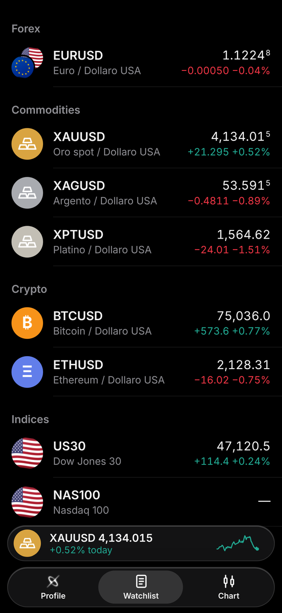
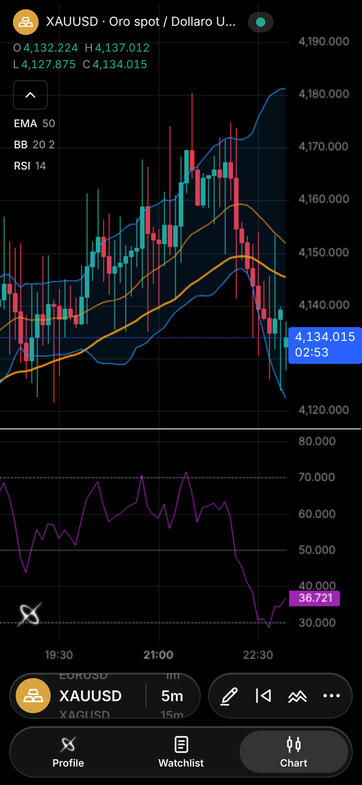
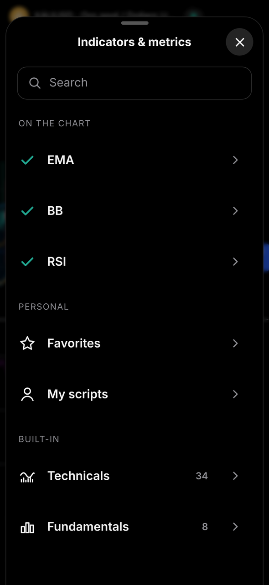
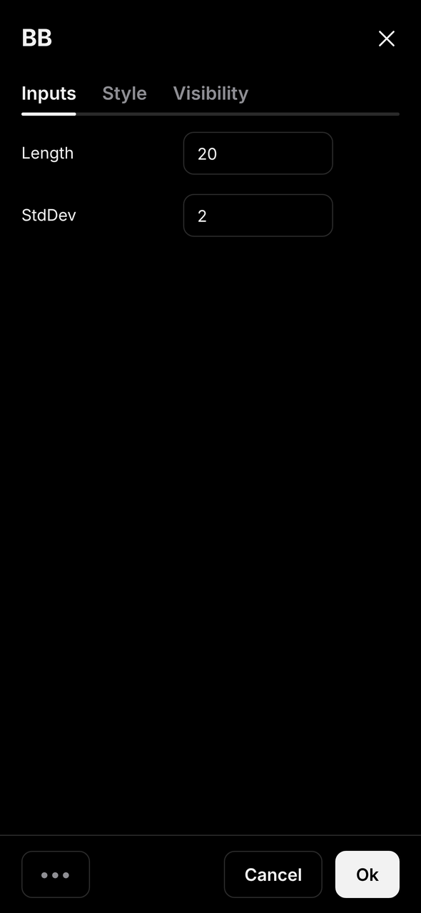
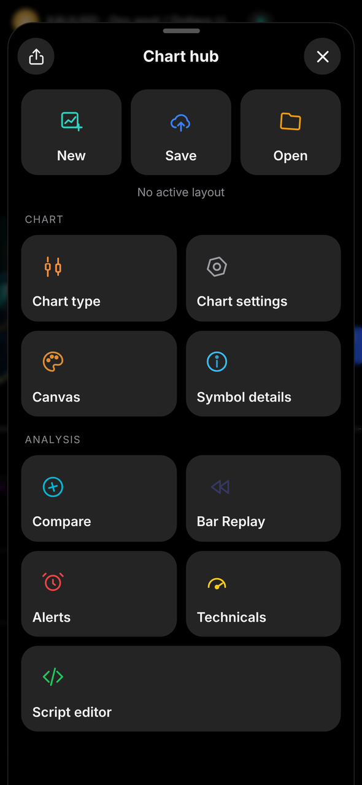
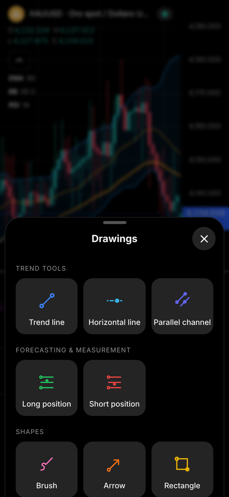
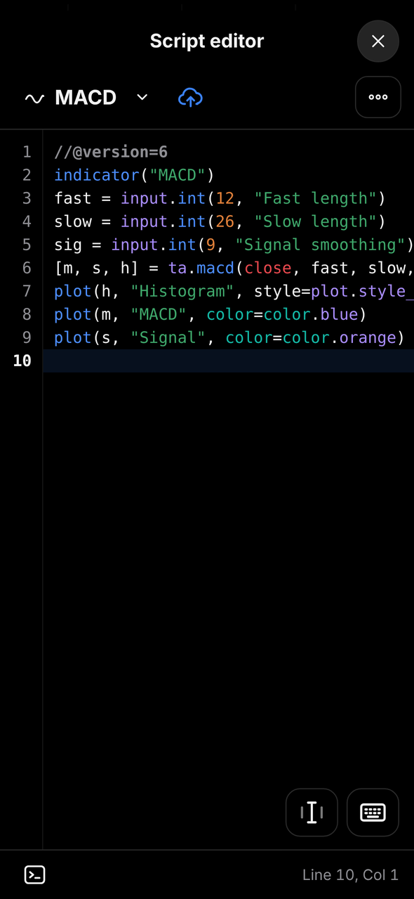

# NexusCharts

**Real-time charts, indicators, scripts and alerts — right in your pocket.**
A fast, beautiful charting app for iPhone, Android and desktop, with a liquid-glass interface.

**English** · [Italiano](README.it.md) · [Español](README.es.md) · [Français](README.fr.md)

  
  
  
  

  
  
  

---

## 📖 Contents

- [What is NexusCharts](#-what-is-nexuscharts)
- [Features](#-features)
- [Installation](#-installation)
- [How to get access](#-how-to-get-access)
- [Compatibility](#-compatibility)
- [Privacy & security](#-privacy--security)
- [FAQ](#-faq)
- [Roadmap](#-roadmap)
- [Credits](#-credits)

---

## ✨ What is NexusCharts

NexusCharts is a **web app** that installs on your Home Screen and works like a real app: full screen, with its own icon, no App Store needed.
It's built for traders who want **clean charts, live prices, indicators and drawing tools** on their phone, without limits, ads or subscriptions.

| | |
|---|---|
| ⚡ **Live prices** | Quotes and candles refresh automatically every few seconds |
| 📈 **42 indicators + your scripts** | Built-in library and a Pine Script™-compatible engine |
| 🔔 **Real alerts** | Push notifications even when the app is closed |
| 📱 **Native feel** | Full screen, haptic feedback, smooth animations, no browser bars |
| 🔄 **Always updated** | Every time you open it you get the latest version automatically |
| 🌍 **4 languages · 2 themes** | Italian, English, Spanish, French · Dark and light |

> 📝 What's new in each version: see the [Releases](../../releases) page.

---

## 🚀 Features

### 📋 Watchlist
- Forex, commodities, crypto, indices and stocks, grouped by category
- Search any symbol and add it with one tap
- Live price, daily change in points and percent, flag/coin icons
- Mini player at the bottom with the selected symbol and its sparkline

### 📊 Chart
- Full-screen chart with **live updates** and a candle **countdown**
- **Timeframes:** 1m · 5m · 15m · 1H · 4H · 1D
- **Chart types:** Candles · Bars · Line · Area · Heikin Ashi
- **Custom colors:** candle body, borders and wicks with opacity, plus canvas background and scales
- **Quick picker:** hold and swipe on the symbol or timeframe pill to change it instantly
- **Crosshair** with price and time labels and a **"+" button** for quick alerts
- **Compare** a second symbol in percentage mode
- Pinch to zoom, drag to scroll, share a snapshot of the chart

### 📈 Indicators
- **Indicators & metrics** screen with search, **Favorites** (tap the star) and **My scripts**
- **34 Technicals:** SMA, EMA, WMA, HMA, VWMA, ALMA, MA Ribbon, Bollinger Bands (+ %B and BandWidth), Keltner, Donchian, Envelopes, Supertrend, Ichimoku, VWAP, Linear Regression, RSI, Stoch RSI, Stochastic, MACD, CCI, ADX, ATR, MFI, Williams %R, Momentum, ROC, Awesome Oscillator, Aroon, OBV, Volume, Pivot Points, ZigZag
- **8 Fundamentals** (computed from prices): Previous Day High/Low, Previous Week High/Low, Daily Open, Average Daily Range, Daily Change %, Historical Volatility, 52-Week High/Low, Session High/Low
- **Compact legend:** tap an indicator to **show/hide** it, open its **settings** or **remove** it
- **Settings window** with **Inputs**, **Style** (visibility, color, width of each line) and **Visibility** (minutes / hours / days)
- **••• menu:** reset settings or **save as default** for the next time you add it

### 🧩 Script editor
- Write your own indicators in a **Pine Script™-compatible** language (v5/v6)
- Code editor with line numbers, error check and console
- Supports plots, shapes, boxes, lines, labels, tables, fills, inputs, alerts, higher timeframes and sessions
- Save your scripts and add them to the chart from **My scripts**

### ✏️ Drawing tools
Saved automatically for each symbol.

| Group | Tools |
|---|---|
| Trend | Trend line · Horizontal line · Parallel channel |
| Forecasting & measurement | Long position · Short position (with target, stop and R:R) |
| Shapes | Brush · Arrow · Rectangle · Path · Ellipse |
| Annotations | Text · Note |

Select a drawing to move it, change its color or delete it.

### 🔔 Alerts
- Create a price alert from the crosshair **"+"** or from the **Alerts** manager
- Alert line on the chart: tap it to delete it
- Active / inactive list, cancel and delete
- **Push notifications even when the app is closed** (can be turned off in Profile › Notifications)

### ⏪ Bar Replay
- Place a **guide line** on the exact candle you want and start from there
- Play at 1x–10x speed or step one candle at a time — perfect for backtesting

### 🧭 Chart Hub
| Section | What it does |
|---|---|
| **Layouts** | New · Save · Open your saved chart setups |
| **Chart** | Chart type, chart settings, canvas, symbol details |
| **Analysis** | Compare · Bar Replay · Alerts · Technicals · Script editor |
| **Technicals** | Buy/sell gauge from oscillators and moving averages |
| **Share** | Creates an image of your chart and opens the share sheet |

### 👤 Profile & settings
- Theme (dark/light), language and notifications
- Feedback form to report a problem or suggest an idea
- Refresh data, safe reset, sign out

---

## 📲 Installation

> NexusCharts is installed from the browser — no App Store or Play Store needed.

### 🍎 iPhone (Safari)
1. Open the NexusCharts link in **Safari**.
2. Tap **Share** (the square with the arrow). On iOS 26 tap the **three dots ⋯** first, then **Share**.
3. Tap **Add to Home Screen** (if you don't see it, tap **View More**).
4. Keep **Open as Web App** on, check the name is **NexusCharts**, tap **Add**.
5. Open **NexusCharts** from your Home Screen.

### 🤖 Android (Chrome)
1. Open the NexusCharts link in **Chrome**.
2. Tap the **three dots ⋮** at the top right.
3. Tap **Install app** (or **Add to Home screen**) and confirm.

### 💻 Desktop (Chrome / Edge)
1. Open the NexusCharts link.
2. Click the **install icon** in the address bar, or open it in a normal tab.

> 💡 The same guide is available inside the app: tap **Install** at the top left of the login screen.

---

## 🔑 How to get access

NexusCharts uses **personal access codes** — no sign-up, no broker account needed.

1. Ask for your code on Telegram 👉 **[t.me/albaexe](https://t.me/albaexe)**
2. Open the app and tap **Sign in without a broker**.
3. Type your code (format `XXXX-XXXX`) — you're in.

From then on the app signs you in automatically.

> ⚠️ Every code works on **one device only**, like a license. If you change phone or reset the app, just ask for a new one.

---

## ✅ Compatibility

| Device | Browser | Status |
|---|---|---|
| iPhone (iOS 16.4 or later) | Safari | ✅ Recommended |
| iPhone | Chrome / Edge | ✅ Works (install via Share) |
| Android 10 or later | Chrome | ✅ Supported |
| Android | Samsung Internet / Edge | ✅ Works |
| iPad | Safari | ⚠️ Works, designed for phones |
| Desktop | Chrome / Edge / Safari | ⚠️ Works, full desktop version coming |

**Requirements:** an internet connection. Push notifications on iPhone need the app installed on the Home Screen.

---

## 🔒 Privacy & security

- 🚫 **No personal data required** to use the app with a code.
- 📱 Drawings, layouts, indicators, scripts and settings are saved **only on your device**.
- 🔔 If you turn on notifications, your active price alerts are kept on the server only to notify you; delete an alert and it's gone.
- 🔐 No passwords or private keys are stored in this repository.
- 🎟️ Access codes are tied to a single device and can be revoked at any time.
- 🧹 **Reset app** erases everything saved on the device.

---

## ❓ FAQ

<b>Do I need to pay or subscribe?</b>

No. Installing and using NexusCharts is free — you only need an access code.

<b>Do I need a broker account?</b>

No. With an access code you sign in without any broker registration.

<b>Can I trade from the app?</b>

No. NexusCharts is for charts and analysis only — it never places orders.

<b>Can I use my own Pine Script™ indicators?</b>

Yes. Paste your script in the Script editor, save it and add it from My scripts. Most v5/v6 features are supported; if something isn't, the console tells you the line.

<b>Do price alerts work when the app is closed?</b>

Yes, with push notifications on. On iPhone the app must be installed on the Home Screen.

<b>My code says it's already used on another device.</b>

Each code works on one device only. Ask for a new one on Telegram.

<b>Do I need to update the app?</b>

No. It updates itself every time you open it.

<b>Do my drawings and indicators sync between devices?</b>

Not yet: they're saved on the device where you made them.

---

## 🗺️ Roadmap

| Status | Feature |
|---|---|
| ✅ | Watchlist, live chart, timeframes, chart types, custom colors |
| ✅ | Drawing tools, Bar Replay, Chart Hub, layouts |
| ✅ | 42 built-in indicators, favorites, indicator settings |
| ✅ | Pine Script™-compatible engine and script editor |
| ✅ | Price alerts with push notifications |
| ✅ | 4 languages, dark and light theme |
| 🔜 | Faster data loading |
| 🔜 | Full desktop version |
| 💡 | Sync between devices |

---

## 🙏 Credits

- Charts powered by [TradingView Lightweight Charts™](https://www.tradingview.com/lightweight-charts/) (Apache 2.0).
- TradingView and Pine Script are trademarks of TradingView, Inc. NexusCharts is not affiliated with TradingView.

---

## ⚠️ Disclaimer

NexusCharts is an analysis tool. Nothing in the app is financial advice. Trading involves risk: always do your own research.

**© 2026 NexusCharts — All rights reserved.**

